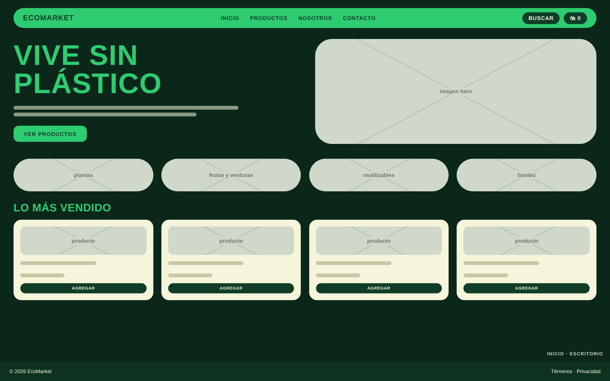
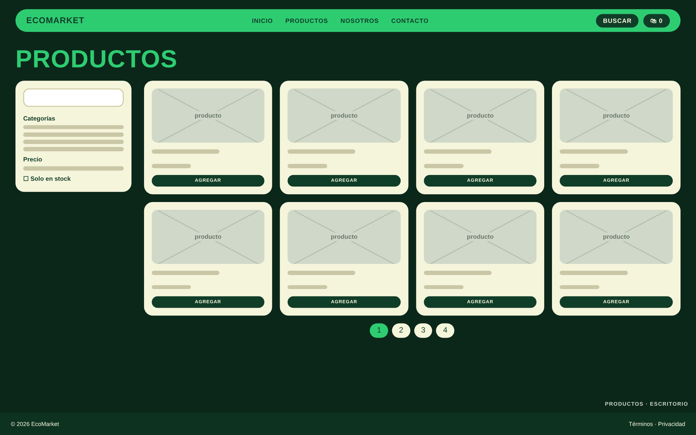
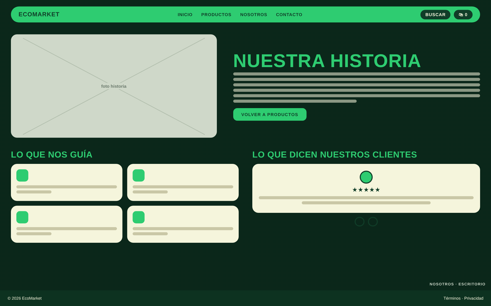
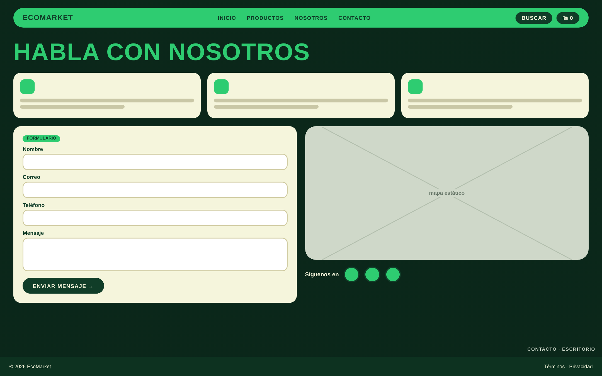
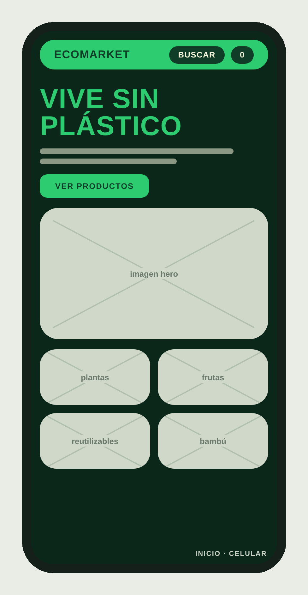
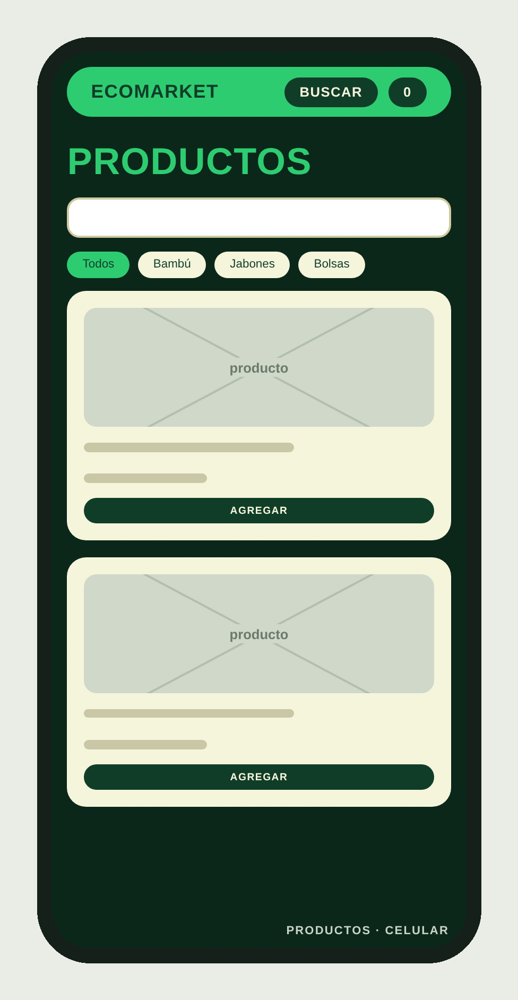
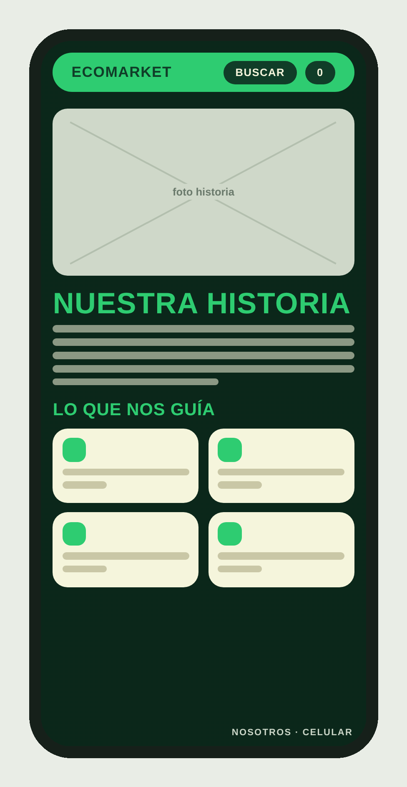
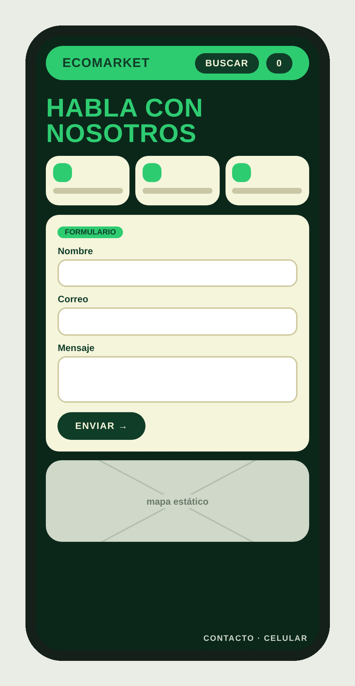

# 🌿 EcoMarket

Tienda en línea de productos ecológicos y reutilizables para reemplazar el plástico de uso diario. Proyecto estático hecho solo con **HTML5 y CSS3** (sin JavaScript), con diseño **mobile-first** y flujo de trabajo **Git Flow**.

🔗 **Sitio publicado:** _pendiente de despliegue (Netlify o Vercel)_
📦 **Repositorio:** https://github.com/samid1097-tech/EcoMarket_SamidPlata

---

## 🎨 Diseño

Antes de programar se planearon las cuatro vistas principales en computador y en celular.

### Vista de computador

| Inicio | Productos |
|:--:|:--:|
|  |  |

| Nosotros | Contacto |
|:--:|:--:|
|  |  |

### Vista de celular

| Inicio | Productos | Nosotros | Contacto |
|:--:|:--:|:--:|:--:|
|  |  |  |  |

### Paleta de colores

| Color | Código | Uso |
|---|---|---|
| Verde principal | `#2ecc71` | Menú, botones y títulos |
| Verde medio | `#27ae60` | Acentos y estados al pasar el mouse |
| Beige | `#f5f5dc` | Tarjetas y fondos claros |
| Verde bosque | `#103d28` | Fondos oscuros y textos |

### Tipografías

- **Anton**: títulos grandes
- **Fraunces**: títulos de sección y citas
- **Mulish**: texto del cuerpo

---

## 📄 Páginas

### Inicio (`index.html`)
Encabezado con menú, sección principal con imagen de fondo, cuatro categorías con fotografías y la sección **Lo más vendido**.

### Productos (`views/productos.html`)
- Catálogo de **20 productos** en cuadrícula de **4, 2 y 1 columnas** según el ancho de pantalla.
- Barra lateral de filtros fija al hacer scroll (`position: sticky`).
- Buscador visual, etiquetas de stock y botón de favoritos hecho solo con CSS.
- Paginación visual.

### Sobre nosotros (`views/sobre-nosotros.html`)
- Historia de la marca en dos columnas con Flexbox.
- Cuatro principios con iconos.
- Carrusel de testimonios hecho solo con CSS (radios y `transform`).
- Animaciones al pasar el mouse.

### Contacto (`views/contacto.html`)
- Formulario con validación visual usando `:valid` y `:invalid`.
- Imagen estática de mapa con enlace a Google Maps.
- Iconos de redes sociales que crecen al pasar el mouse.

---

## 🛠️ Tecnologías

- HTML5 semántico
- CSS3: variables, Flexbox, Grid, `position: sticky`, `:has()`, `:valid` / `:invalid` y animaciones con `@keyframes`
- Diseño mobile-first con puntos de quiebre en 600 px, 900 px y 1200 px
- Git y GitHub con Git Flow

---

## 📁 Estructura del proyecto

```
EcoMarket_SamidPlata/
├── index.html
├── README.md
├── css/
│   ├── main.css          # variables, reset y base
│   ├── layout.css        # estructura de cada página
│   ├── components.css    # botones, tarjetas y formularios
│   └── animations.css    # animaciones
├── img/
│   ├── hero/             # imágenes de la portada
│   ├── icons/            # logos e iconos de redes
│   ├── productos/        # fotos de los productos
│   ├── avatares/         # avatares de los testimonios
│   ├── contacto/         # mapa e iconos de contacto
│   └── readme/           # mockups de este documento
└── views/
    ├── productos.html
    ├── sobre-nosotros.html
    └── contacto.html
```

---

## 🌱 Flujo de trabajo con Git

Se usó **Git Flow**:

- `master`: versión estable.
- `develop`: integración de todo el trabajo.
- `feature/nombre-seccion`: una rama por sección (por ejemplo `feature/productos`, `feature/sobre-nosotros`, `feature/contacto` y `feature/readme`).

Cada rama se une a `develop` con `git merge --no-ff` y, cuando está estable, a `master`.

Los commits siguen **Conventional Commits**:

```
feat(productos): pagina de catalogo con los 20 productos requeridos
style(nosotros): principios y testimonios en dos columnas en escritorio
docs(readme): agrega documentacion del proyecto
```

---

## ▶️ Cómo ver el proyecto

No necesita instalación ni servidor:

```
git clone https://github.com/samid1097-tech/EcoMarket_SamidPlata.git
cd EcoMarket_SamidPlata
```

Después abre `index.html` en el navegador.

---

## 👤 Autor

**Samid Plata**: Campuslands

## 🙌 Créditos

- Fuentes: [Google Fonts](https://fonts.google.com/)
- Los testimonios de la página Sobre nosotros son de ejemplo.
